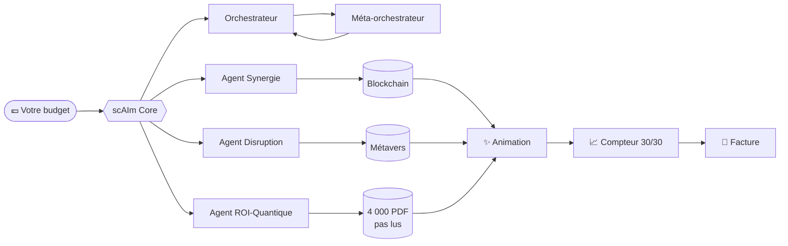

<div align="center">

# sc**AI**m™

### L'IA agentique qui orchestre l'orchestration de vos agents.

*Sans code. Sans humain. Sans résultat.*


-5f8a4e)


**[▶ Voir la démo live](https://xavierbeheydt.github.io/scaim/)**

</div>

> [!WARNING]
> **Ceci est une satire.** scAIm™ n'est pas un vrai produit et ne fait volontairement rien d'utile. C'est une parodie des « solutions IA miracles » vendues à coups d'animations et de compteurs. Aucune personne ni entreprise réelle n'est visée.

---

## ✨ Qu'est-ce que scAIm™ ?

scAIm™ déploie un **essaim de 7 agents IA autonomes, multimodaux et post-quantiques** qui alignent vos paradigmes, tokenisent votre ROI et transforment vos process en *expériences cognitives scalables*.

En 12 secondes, scAIm™ accomplit **30 tâches**. Il y a un compteur, et il monte.

## 🧠 Architecture



## 🚀 Installation

```bash
git clone https://github.com/XavierBeheydt/scaim.git
cd scaim
npm start
```

Zéro dépendance. Zéro configuration. Zéro valeur ajoutée.

## 📊 Benchmarks

| Métrique                     | scAIm™ v4.2 | Un humain compétent |
|------------------------------|:-----------:|:-------------------:|
| Tâches orchestrées           | **30**      | 0                   |
| Problèmes réellement résolus | 0           | **Plusieurs**       |
| Coches vertes par seconde    | **2,5**     | 0                   |
| Capacité à dire « je ne sais pas » | Non   | **Oui**             |
| Prix mensuel                 | 14 990 € HT | Raisonnable         |

## 🗺️ Roadmap

- [x] Animation de nœuds qui clignotent
- [x] Compteur jusqu'à 30
- [x] Dégradé sur la barre de progression
- [ ] Compteur jusqu'à 100 (offre Enterprise)
- [ ] Confettis
- [ ] Faire un truc utile *(reporté au sprint 47)*

## ❓ FAQ

**Comment fonctionnent les agents ?**
Lisez [`src/agents.js`](src/agents.js). Vraiment, lisez-le.

**Où vont mes données ?**
Excellente question. Suivante.

**Que se passe-t-il quand l'IA se trompe ?**
Elle ne se trompe jamais : elle renvoie `"✓"` à chaque fois.

**C'est une arnaque ?**
C'est dans le nom.

---

## Bon. Sérieusement.

scAIm™ n'existe pas. Mais vous avez forcément croisé son cousin cette semaine dans votre fil LinkedIn ou X : un « architecte IA », un « sorcier des agents », une jolie animation, un compteur qui monte, et zéro détail sur ce qui est réellement fait.

Quand on me présente ce genre d'outil, je me pose toujours les mêmes questions. **Où vont aller mes données**, et qui pourra les lire ? Que se passe-t-il **s'il se trompe en les traitant**, et **qui s'en rendra compte** ? Est-ce que je l'ai vu tourner sur **un vrai dossier**, ou seulement sur la démo ?

En vrai, une bonne partie des « besoins IA » se règlent avec **un petit script, un export bien fait ou un tableur propre**. Ça fait moins rêver, mais ça tourne, ça coûte trois fois rien, et **on sait ce qu'il y a dedans**.

J'utilise l'IA tous les jours. Elle est utile quand elle répond à un vrai problème, bien posé, avec quelqu'un qui comprend ce qu'il construit.

**Xavier Beheydt** — développeur, pas sorcier.

---

<sub>scAIm™ est une parodie. Aucun agent n'a été maltraité pendant la réalisation de ce dépôt. Licence MIT : forkez, riez, partagez.</sub>
