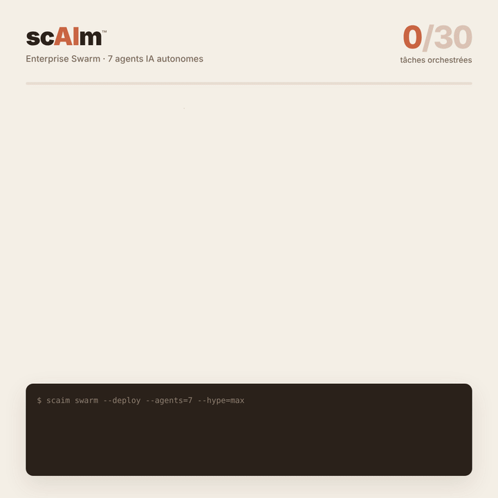
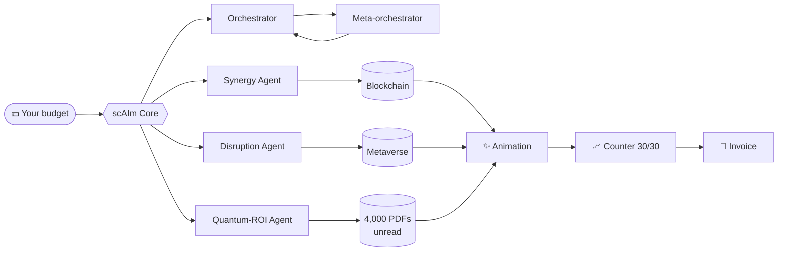

<div align="center">

# sc**AI**m™

### The agentic AI that orchestrates the orchestration of your agents.

*No code. No humans. No results.*


-5f8a4e)




**[▶ Watch the live demo](https://xavierbeheydt.github.io/scaim/)**

</div>

> [!WARNING]
> **This is satire.** scAIm™ is not a real product and deliberately does nothing useful. It is a parody of the "miracle AI solutions" sold with animations and counters. No real person or company is targeted.

---

## ✨ What is scAIm™?

scAIm™ deploys a **swarm of 7 autonomous, multimodal, post-quantum AI agents** that align your paradigms, tokenize your ROI and turn your processes into *scalable cognitive experiences*.

In 12 seconds, scAIm™ completes **30 tasks**. There is a counter, and it goes up.

## 🧠 Architecture



## 🚀 Installation

```bash
git clone https://github.com/XavierBeheydt/scaim.git
cd scaim
npm start
```

Zero dependencies. Zero configuration. Zero added value.

## 📊 Benchmarks

| Metric                       | scAIm™ v4.2 | A competent human |
|------------------------------|:-----------:|:-----------------:|
| Tasks orchestrated           | **30**      | 0                 |
| Problems actually solved     | 0           | **Several**       |
| Green checkmarks per second  | **2.5**     | 0                 |
| Ability to say "I don't know" | No         | **Yes**           |
| Monthly price                | €14,990 excl. VAT | Reasonable  |

## 🗺️ Roadmap

- [x] Blinking node animation
- [x] Counter up to 30
- [x] Gradient on the progress bar
- [ ] Counter up to 100 (Enterprise plan)
- [ ] Confetti
- [ ] Do something useful *(postponed to sprint 47)*

## ❓ FAQ

**How do the agents work?**
Read [`src/agents.js`](src/agents.js). Seriously, read it.

**Where does my data go?**
Excellent question. Next.

**What happens when the AI is wrong?**
It is never wrong: it returns `"✓"` every time.

**Is this a scam?**
It's in the name.

---

## Okay. Seriously.

scAIm™ doesn't exist. But you've surely run into its cousin this week on your LinkedIn or X feed: an "AI architect", an "agent wizard", a pretty animation, a counter going up, and zero detail about what is actually being done.

When someone shows me this kind of tool, I always ask the same questions. **Where will my data go**, and who will be able to read it? What happens **if it gets it wrong while processing it**, and **who will notice**? Have I seen it run on **a real case**, or only on the demo?

Honestly, a good share of "AI needs" can be solved with **a small script, a well-made export or a clean spreadsheet**. It's less exciting, but it works, it costs next to nothing, and **you know what's inside**.

I use AI every day. It is useful when it answers a real, well-posed problem, with someone who understands what they are building.

**Xavier Beheydt** — developer, not a wizard.

---

<sub>scAIm™ is a parody. No agents were harmed in the making of this repository. MIT license: fork it, laugh, share.</sub>
